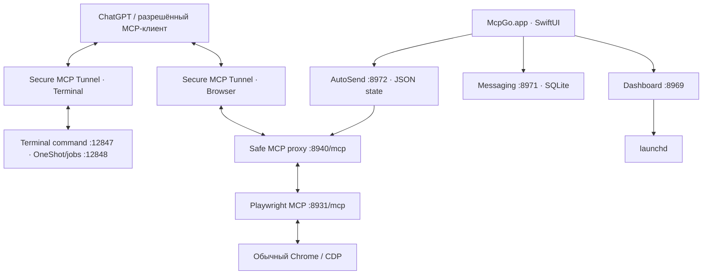

# McpGo — технический справочник

**Self-hosted macOS control plane: Terminal MCP, управление личным Chrome через Playwright, Secure MCP Tunnels, локальная очередь агентов и AutoSend.**

**Актуальность:** 7 ноября 2026. **Стадия:** работающая локальная референс-установка, не опубликованный дистрибутив. Этот документ адресован разработчику, оператору, аудитору безопасности и будущему участнику открытого проекта.

> **Обещание прозрачности.** Для каждого существенного технического утверждения указаны исходные файлы или проверяемые команды. Мы не называем PID гарантией работающего MCP; успешный клик — выполненной задачей; localhost — полноценной песочницей; а проект — юридически open source до выбора лицензии и публикации исходников.

## 1. Что делает McpGo

McpGo — нативная панель SwiftUI для управления локальными службами, которые пользователь осознанно подключает к ChatGPT workspace по MCP. Приложение не является альтернативным LLM, не читает произвольные истории разговоров через внутреннее API ChatGPT и не развёртывает собственное публичное облако.

| Возможность | Реализация | Ограничение |
|---|---|---|
| Terminal | ChatTerminalHub: интерактивные PTY, OneShot, detached jobs | Shell работает с правами пользователя macOS |
| Browser | Playwright MCP → CDP → обычный Google Chrome | Нет изоляции личного Chrome-профиля |
| MCP connections | Два независимых Secure MCP Tunnels | Разрешения клиента и macOS критичны |
| Lifecycle | SwiftUI → Dashboard :8969 → launchctl | Запуск процесса ≠ проверка E2E |
| Agent coordination | Messaging :8971, SQLite queue | Очередь не читает закрытые транскрипты |
| Scheduled messages | AutoSend :8972 → Playwright → конкретный chat URL | Не подтверждает завершение ответа |
| Agent Skills | Четыре SKILL.md, встроенные в bundle | Текст не предоставляет новых разрешений |

### Предназначено для

**Оператор** — восстановить подключение и понять логи. **Разработчик** — изменить модуль и запустить тесты. **Аудитор** — проследить пути данных и возможные полномочия. **Контрибьютор** — отправить изменение без нарушения сохранённых пользовательских данных.

## 2. Юридический и релизный статус

Текущий локальный каталог **не является готовым публичным репозиторием**: в нём нет `.git`, не выбран `LICENSE`, отсутствует универсальный установщик, имеются абсолютные пути текущей машины и исторические локальные артефакты. Наличие `CONTRIBUTING.md` или `.gitignore` не означает, что исходники можно автоматически публиковать, перепродавать или изменять на условиях открытой лицензии.

**Не публикуйте рабочую папку целиком.** Перед открытием нужен чистый source-only экспорт, проверка исключений и зависимостей, выбранная лицензия, переносимая установка, аудит привилегий и повторяемые тесты в чистом профиле.

## 3. Принципы архитектуры

1. **Владелец контролирует Mac.** Команды выполняются с правами локального пользователя.
2. **Личный Chrome по CDP.** Отдельный Chromium и отдельный браузерный профиль штатно не запускаются.
3. **Два MCP-контура.** TerminalHub и PlaywrightHub имеют разные службы и туннели.
4. **Safe proxy перед браузерным туннелем.** Внешний browser MCP подключается через `8940/mcp`, не через raw `8931/mcp`.
5. **AutoSend — state machine.** Перед кликом фиксируется commit barrier; после неясного результата автоматический повтор запрещён.
6. **Совместимость системных ID.** Имя McpGo не означает безопасного автоматического переименования `com.mcphub.*`.
7. **Данные не всегда остаются локальными.** Terminal/browser MCP ответы могут отправляться подключённому клиенту; Chrome делает обычные внешние запросы.
8. **Документация отделяет PASS от неизвестного результата.** Невыполненные проверки не объявляются успешными.

## 4. Архитектура на одном экране



Схема логическая: конечные адреса туннелей определяются конфигурацией конкретной установки.

## 5. Безопасная диагностика

```bash
launchctl list | grep -E 'com\.chatterminalhub|com\.mcphub'
curl -fsS http://127.0.0.1:12847/health
curl -fsS http://127.0.0.1:12848/health
curl -fsS http://127.0.0.1:8969/api/status
```

Некоторые локальные HTTP API требуют собственные клиентские заголовки: отказ простого `curl` без них не равен падению службы. После проверки процессов и портов выполните **реальный безопасный вызов** `terminal_exec` или `browser_tabs(list)` из ChatGPT. Только это проверит всю цепочку.

## 6. Полная карта технических глав

| Раздел | Документ | Содержание |
|---|---|---|
| Первый запуск | [GETTING_STARTED.md](docs/GETTING_STARTED.md) | Требования, Chrome, initial tunnel setup |
| Первое подключение | [ONBOARDING.md](docs/ONBOARDING.md) | Tunnel provisioning, Keychain, recovery |
| Архитектура | [ARCHITECTURE.md](docs/ARCHITECTURE.md) | Слои, направления вызовов, ограничения |
| Компоненты | [COMPONENTS.md](docs/COMPONENTS.md) | Ответственность и исходные файлы |
| Native GUI | [DESKTOP.md](docs/DESKTOP.md) | SwiftUI, состояние, вкладки, кнопки |
| Терминал | [TERMINAL.md](docs/TERMINAL.md) | PTY, OneShot, job runtime |
| Браузер | [BROWSER.md](docs/BROWSER.md) | Chrome CDP, shared proxy, session |
| Агенты | [MESSAGING.md](docs/MESSAGING.md) | База, CLI, роли и lifecycle |
| Расписания | [AUTOSEND.md](docs/AUTOSEND.md) | Точные стадии и инварианты доставки |
| Контракты | [INTERFACES.md](docs/INTERFACES.md) | MCP и localhost API |
| Настройки | [CONFIGURATION.md](docs/CONFIGURATION.md) | launchd, ENV, пути и порты |
| Зависимости и supply chain | [DEPENDENCIES.md](docs/DEPENDENCIES.md) | Node lockfile, Chrome, Swift, Python, tunnel-client |
| Данные | [DATA.md](docs/DATA.md) | Места хранения, очистка, резервирование |
| Безопасность | [SECURITY.md](docs/SECURITY.md) | Модель угроз, границы доверия |
| Подробная модель угроз | [THREAT_MODEL.md](docs/THREAT_MODEL.md) | STRIDE, capabilities и остаточные риски |
| Независимая проверка | [AUDIT_GUIDE.md](docs/AUDIT_GUIDE.md) | Что проверять в исходниках |
| Реестр исходников | [SOURCE_INVENTORY.md](docs/SOURCE_INVENTORY.md) | Source code map с контрольными хэшами |
| Частые вопросы | [FAQ.md](docs/FAQ.md) | Доступы, privacy, лицензия, удаление |
| Отказы | [FAILURE_MODES.md](docs/FAILURE_MODES.md) | Инциденты и recovery |
| Сборка | [DEVELOPMENT.md](docs/DEVELOPMENT.md) | Swift, Node, Python, тесты |
| Packaging | [PACKAGING.md](docs/PACKAGING.md) | Bundle, подпись, installer gap |
| Доказательства | [VERIFICATION.md](docs/VERIFICATION.md) | Матрица тестирования и E2E |
| Эксплуатация | [OPERATIONS.md](docs/OPERATIONS.md) | Рестарты, backup, диагностика |
| Миграции | [MIGRATION.md](docs/MIGRATION.md) | Исторические ID и пути |
| Публикация | [PUBLIC_RELEASE.md](docs/PUBLIC_RELEASE.md) | Гейт открытия репозитория |
| Участие | [CONTRIBUTING.md](CONTRIBUTING.md) | Стандарты PR и тестов |
| Поддержка | [SUPPORT.md](SUPPORT.md) | Статус каналов поддержки и самостоятельная диагностика |
| Политика безопасности | [SECURITY.md](SECURITY.md) | Текущее состояние публичного security reporting |
| История | [CHANGELOG.md](CHANGELOG.md) | Версии и изменения |

## 7. Исходный код по подсистемам

```text
native/         SwiftUI/AppKit, окна, UI-состояние, настройки, иконка
dashboard/      HTTP status/control API и веб-панель
terminal/       terminal_create/send/read/close, OneShot, jobs, PTY
playwright/     Chrome CDP backend, shared-session proxy, browser tunnel
autosend/       Scheduler, JSON state, click-committed delivery, legacy adapters
messaging/      SQLite agents/messages/reads, HTTP/CLI
launchagents/   macOS LaunchAgent templates
launchers/      wrappers для запуска browser/tunnel
skills/         инструкции для ChatGPT, не привилегии
tests/          регрессионные проверки
docs/           инженерная документация
```

Для проверки информации откройте исходные файлы: `terminal/server.js:toolSchemas`, `terminal/stateless_server.js`, `playwright/restricted-proxy.mjs`, `autosend/cdp-delivery.mjs:deliverViaPlaywright`, `autosend/core.mjs`, `messaging/hub.py`, `dashboard/server.mjs`.

## 8. Где проходит граница Mac ↔ внешний мир

| Канал | Возможные данные за пределами Mac | Контроль |
|---|---|---|
| Terminal MCP tunnel | Выбранные команды, stdout/stderr, результаты инструментов | Разрешённый MCP-клиент и контур tunnel |
| Browser MCP tunnel | Выбранные действия, DOM и возвращённые результаты | MCP-клиент + browser proxy |
| Chrome → интернет | Обычный сетевой трафик посещаемого сайта, авторизация пользователя | Chrome и его профиль |
| AutoSend → ChatGPT | Текст сообщения, ввод в выбранную страницу | Пользовательское расписание |
| Messaging | Локально хранит явно опубликованные сообщения, которые могут быть возвращены агенту | Локальные CLI/HTTP и разрешения MCP |

Не утверждается, что все данные остаются на устройстве, что общему Chrome-профилю обеспечена изоляция или что все инструменты проходят строгий allowlist. Текущий proxy блокирует конкретный опасный инструмент — это не универсальный policy engine.

## 9. Типовой жизненный цикл

1. Открыть McpGo и проверить, какие LaunchAgents зарегистрированы.
2. Проверить Chrome remote debugging и доступность Playwright backend/proxy.
3. Проверить два tunnel-client процесса и их association с нужным workspace.
4. Вызвать безопасный MCP-инструмент из разрешённого ChatGPT разговора.
5. Для jobs — дождаться окончательного `job_status`, а не только `job_start`.
6. Для AutoSend — проверить точный URL, статус расписания и журнал попыток.
7. При неизвестном исходе отправки **не** включать повтор, пока пользователь не проверит адресата.
8. Перед обновлением создать согласованную резервную копию локального состояния.

## 10. Невыполненные требования публичного релиза

- Нет утверждённой лицензии `LICENSE`.
- Нет гарантированно переносимого macOS installer/uninstaller.
- Есть системные и файловые идентификаторы референс-установки.
- Нужны CI, тест чистой машины, software supply-chain audit.
- Нужны документация по поддерживаемым версиям и security contact.
- До публикации необходимо исключить локальные базы, журналы, историю собранных приложений и другие рабочие файлы.

Подробный перечень с критериями готовности — [PUBLIC_RELEASE.md](docs/PUBLIC_RELEASE.md).

## 11. Что самостоятельно проверить, чтобы доверять проекту

**Проверяемость вместо обещаний:** через `grep`/поиск в исходниках подтвердите, где фактически происходит HTTP bind, какую команду запускает `launchd`, какие MCP-tools экспортируются, что фильтрует browser proxy, на каком шаге AutoSend сохраняет состояние до клика и какие поля очереди сохраняются в SQLite.

Затем выполните проверки из [VERIFICATION.md](docs/VERIFICATION.md). Если тест не запускался, отмечайте его **NOT RUN**; если результат неясен, **UNKNOWN**. Проекту нужны проверяемые границы безопасности, а не формулировка «полностью безопасно».

---

**Дата пересмотра:** 2026-11-07. **Режим распространения:** до принятия лицензии и подготовки публичного репозитория не определён.
