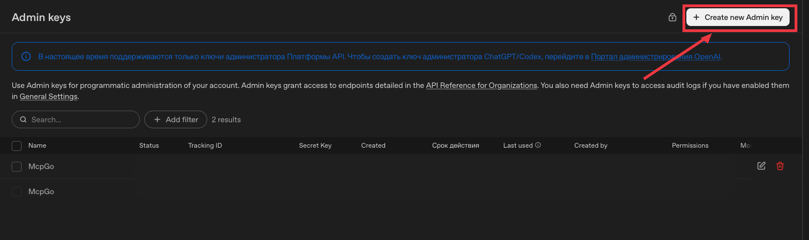
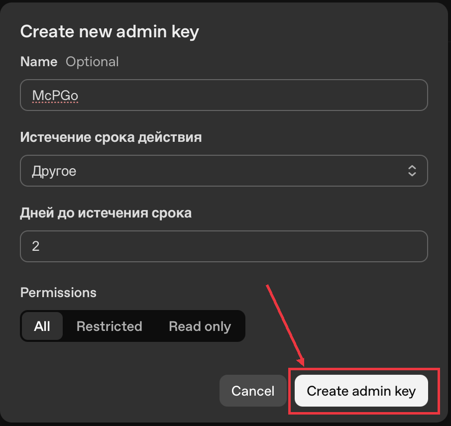
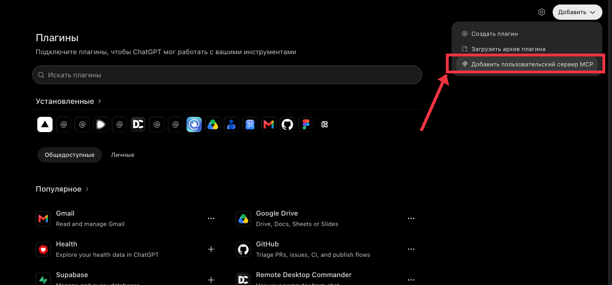
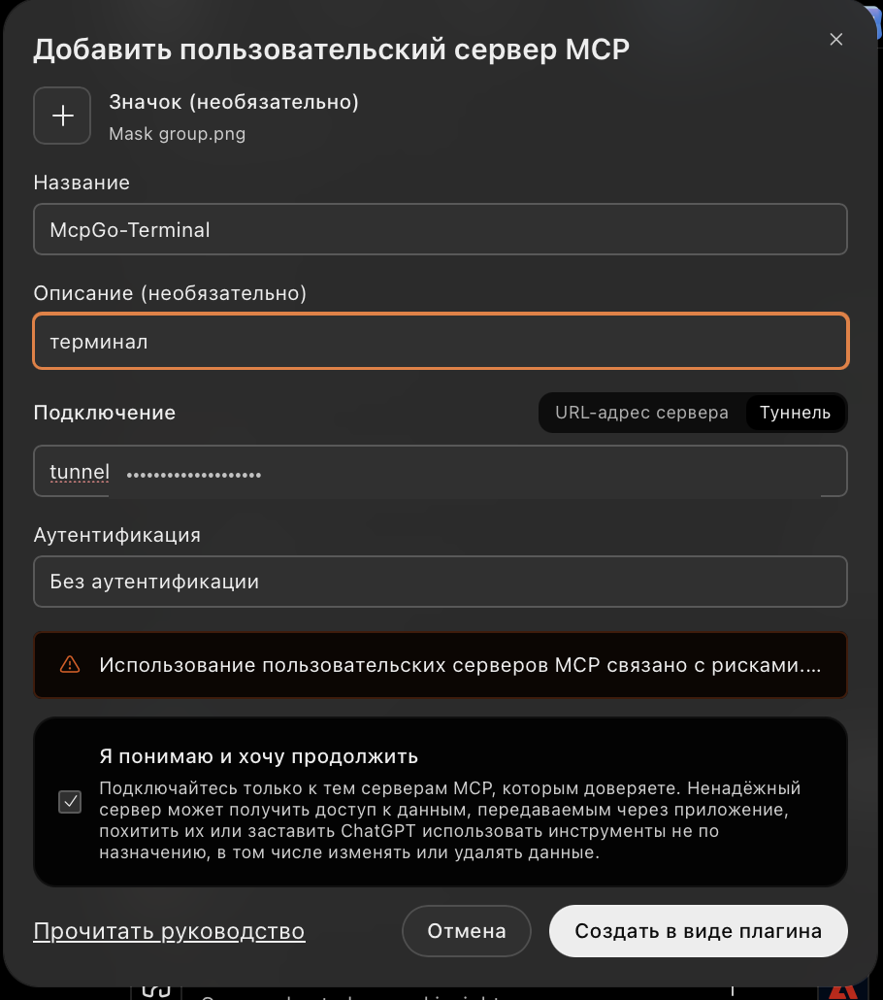
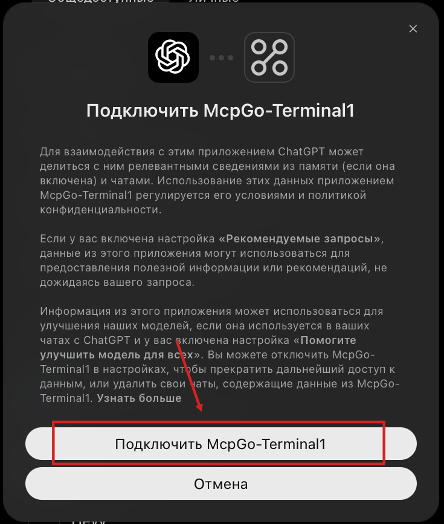

# McpGo

**ChatGPT, который может работать на твоём Mac — в привычном чате.**

Нативное приложение для macOS: терминал, вкладки Chrome через Playwright, длительные задания, автоматизация и подключение через MCP.

[**Скачать приложение**](https://github.com/mcpgo1/McpGo/releases) · [**Установка**](#установка-для-обычного-пользователя) · [**Первое подключение**](#первое-подключение-к-chatgpt) · [**Telegram**](https://t.me/+b-9uv2kRF75jNDFi)


[](LICENSE)


---

## Что это такое — за 30 секунд

McpGo — **бесплатное приложение с открытым исходным кодом** для macOS. Оно подключает локальные инструменты компьютера к поддерживаемому MCP-клиенту, например ChatGPT. Ты ставишь задачу в чате, а инструменты могут выполнить разрешённые действия на подключённом Mac.

- **Код:** читать и редактировать файлы, запускать команды, сборки и тесты.
- **Браузер:** использовать открытые вкладки личного Google Chrome через Playwright/CDP.
- **Долгие задания:** получать статус, логи и сохранённые результаты даже после обрыва диалога.
- **Автоматизация:** отправлять сообщения по расписанию с проверкой состояния чата.
- **Подключения:** управлять локальными службами и двумя Secure MCP Tunnels через мастер.

McpGo **не заменяет ChatGPT** и не предоставляет доступ к компьютеру посторонним людям без настройки соответствующих подключений. Команды выполняются с правами пользователя macOS.

### Что понадобится

| Требование | Зачем |
|---|---|
| **Mac с Apple Silicon (M1+), macOS 14+** | Поддерживаемая стабильная платформа; Intel Mac не поддерживается |
| **Windows 11 x64** | [Windows preview](windows/README.md): исходники и тестовая сборка, пока без подписанного релиза |
| **ChatGPT с пользовательскими MCP-подключениями** | Вызов инструментов из чата; доступность зависит от аккаунта и workspace |
| **Разрешения на Secure MCP Tunnels в OpenAI Platform** | Создание и подключение туннелей |
| **Google Chrome** *(необязательно)* | Если требуется Playwright и работа с существующими вкладками |
| **Интернет** | Первоначальная авторизация и защищённое соединение |

Локальные MCP-инструменты не требуют отдельной покупки API-токенов Codex; ChatGPT используется по условиям доступного тарифа.

## Где скачать McpGo

**Хочешь пользоваться — скачивай DMG, не ZIP с исходниками.**

| Цель | Где искать | Что получишь |
|---|---|---|
| **Установить на Mac** | [GitHub Releases](https://github.com/mcpgo1/McpGo/releases) → последняя версия → **Assets** | Файл вида `McpGo-2.0.3-macos-arm64.dmg` |
| **Посмотреть исходники** | **Code → Download ZIP** на странице репозитория | Исходный код, **не готовое приложение** |
| **Узнать, как настроить** | [Первый запуск](docs/GETTING_STARTED.md) | Шаги настройки и проверки |
| **Запустить исходники сайта** | [Папка `website/`](website/) | Next.js сайт, **не установщик** |

> **Актуальный статус:** локально подготовлен DMG **2.0.3**, подписанный Developer ID и нотарифицированный Apple. **Пока его нет в GitHub Releases, готовое приложение скачать с GitHub нельзя.** Тест установки на полностью чистом Mac проверяется отдельно.


## Установка для обычного пользователя

**Git, Xcode, Node.js, Python и терминал не нужны для обычной установки** — необходимые компоненты входят в релизный DMG.

1. Открой [GitHub Releases](https://github.com/mcpgo1/McpGo/releases), выбери последнюю опубликованную версию и раскрой **Assets**.
2. Скачай **`.dmg` для macOS arm64**. Не скачивай `Source code (zip)`: это только код.
3. Открой DMG и перетащи **McpGo.app** в **«Программы» / Applications**.
4. Запусти McpGo из «Программы» и подтверди обычный системный запрос macOS при первом запуске, если он появится.
5. Перейди в раздел **«Первое подключение»** и выполняй шаги мастера по порядку.
6. Если нужен доступ к браузеру, отдельно настрой Google Chrome и дай необходимые разрешения.
7. Подключи MCP-серверы в ChatGPT и проверь работу **безопасным тестовым вызовом**.

**Установка приложения и создание туннелей — разные действия.** Для второго нужны соответствующие права в OpenAI Platform. Подписка ChatGPT сама по себе не гарантирует право создавать Secure MCP Tunnels.

<details>
<summary><strong>Не вижу DMG в Releases — что делать?</strong></summary>

Если список релизов пуст, публичная загрузка ещё не началась. Не устанавливай файлы из непроверенных источников. Пока можно изучить исходники или написать в [Telegram-канал](https://t.me/+b-9uv2kRF75jNDFi).

</details>

## Первое подключение к ChatGPT

Мастер McpGo показывает, какие компоненты работают, что требуется настроить и где нужно подтверждение.

1. **Проверка установки.** Запусти McpGo → «Первое подключение», проверь локальные компоненты.
2. **OpenAI Platform.** Укажи нужную организацию и workspace с разрешениями на **Secure MCP Tunnels**.
3. **Создание туннелей.** Через мастер настрой подключения **Terminal** и **Browser**: у них независимые адреса и службы.
4. **Локальные службы.** Разреши настройку и запуск только нужных компонентов.
5. **ChatGPT.** В настройках пользовательских MCP-подключений добавь адреса серверов, которые выдал мастер, и подтверди подключение.
6. **Проверка.** Вызови сначала безопасный диагностический инструмент терминала, затем при необходимости инструмент браузера. Статус «туннель запущен» ещё не доказывает, что инструмент доступен из чата.

<details>
<summary><strong>Показать пример: где создать ключ в OpenAI Platform</strong></summary>





</details>

<details>
<summary><strong>Показать пример: где подключить McpGo в ChatGPT</strong></summary>







</details>

Подробности: [быстрый старт](docs/GETTING_STARTED.md) · [мастер подключения](docs/ONBOARDING.md) · [восстановление](docs/FAILURE_MODES.md).


## Что где находится

| Папка | Что внутри |
|---|---|
| [`native/`](native/) | Приложение SwiftUI/AppKit, окно, мастер, настройки |
| [`windows/`](windows/) | Windows-оболочка Electron, адаптеры и тестовый установщик NSIS |
| [`terminal/`](terminal/) | Терминал MCP, интерактивные сессии, команды, задания |
| [`playwright/`](playwright/) | Управление Chrome, CDP, browser proxy |
| [`autosend/`](autosend/) | Сообщения по расписанию, статусы и восстановление |
| [`onboarding/`](onboarding/) | Мастер первого запуска, настройка MCP-туннелей |
| [`dashboard/`](dashboard/) | Локальное управление службами и их статусом |
| [`messaging/`](messaging/) | Локальная очередь сообщений агентов |
| [`launchagents/`](launchagents/) | Шаблоны фоновых служб macOS |
| [`skills/`](skills/) | Инструкции для работы с инструментами |
| [`website/`](website/) | Исходники сайта (Next.js); не часть DMG |
| [`docs/`](docs/) | Подробные инструкции и инженерная документация |
| [`tests/`](tests/) | Автоматические проверки |
| [`scripts/`](scripts/) | Скрипты разработки и сборки DMG |

**Хочешь просто пользоваться?** Не нужно изучать все папки — начни с [установки](#установка-для-обычного-пользователя).

## Разработчикам: как проверить и собрать

Понадобятся Mac, Xcode Command Line Tools, Git, Python 3, Node.js/npm. Сборка из исходников отличается от установки готового DMG.

```bash
git clone https://github.com/mcpgo1/McpGo.git
cd McpGo
```

**Тесты:**

```bash
python3 -m unittest discover -s tests -v
python3 -m unittest discover -s messaging/tests -v
(cd autosend && node --test tests/*.test.mjs)
(cd playwright && npm ci && node --check restricted-proxy.mjs)
```

**Быстрый просмотр интерфейса SwiftUI на собственном Mac** (не чистая установка):

```bash
./scripts/dev_preview_macos.sh --launch
```

**Локальная сборка DMG:**

```bash
python3 scripts/build_release_dmg.py
```

Без Developer ID это **локальный тестовый образ**, который нельзя публиковать как подписанный релиз. Подробнее — [как собрать и подписать DMG](docs/DMG_RELEASE.md).

Наличие успешных unit-тестов не доказывает корректность работы с внешним MCP-клиентом: отдельно проверяй всю цепочку от ChatGPT до инструмента.


## Если что-то не работает

| Проблема | С чего начать |
|---|---|
| **McpGo не появляется в ChatGPT** | Проверь поддержку пользовательских MCP в аккаунте/workspace, затем адреса подключений. [Быстрый старт](docs/GETTING_STARTED.md) |
| **Не создаются MCP-туннели** | Проверь организацию и разрешения в OpenAI Platform. [Мастер подключения](docs/ONBOARDING.md) |
| **Terminal/Browser не отвечают** | Посмотри статусы служб в McpGo и сделай безопасный MCP-вызов. [Диагностика](docs/OPERATIONS.md) |
| **Chrome не показывает вкладки** | Проверь Chrome/CDP и запрошенные разрешения. [Браузер](docs/BROWSER.md) |
| **Долгое задание «зависло»** | Используй `job_status` / `job_logs`. Не повторяй автоматически действие с неясным исходом. [Надёжность](docs/RELIABILITY.md) |
| **Не отправилось сообщение по таймеру** | Проверь URL чата и журнал отправок, прежде чем повторять. [AutoSend](docs/AUTOSEND.md) |
| **После перезапуска Mac нет связи** | Проверь фоновые службы и туннели. [План восстановления](docs/TUNNEL_RECOVERY_PLAN.md) |

## Полезная документация

- [**Первый запуск и требования**](docs/GETTING_STARTED.md) — установка и первые проверки.
- [**Мастер подключения**](docs/ONBOARDING.md) — доступы, workspace, туннели, восстановление.
- [**Архитектура**](docs/ARCHITECTURE.md) и [компоненты](docs/COMPONENTS.md) — как устроен McpGo.
- [**Browser**](docs/BROWSER.md), [**Terminal**](docs/TERMINAL.md), [**AutoSend**](docs/AUTOSEND.md) — конкретные подсистемы.
- [**Надёжность заданий**](docs/RELIABILITY.md), [**восстановление**](docs/TUNNEL_RECOVERY_PLAN.md).
- [**Данные**](docs/DATA.md), [**безопасность**](SECURITY.md), [**модель угроз**](docs/THREAT_MODEL.md).
- [**Сборка и разработка**](docs/DEVELOPMENT.md), [**выпуск DMG**](docs/DMG_RELEASE.md), [**проверки**](docs/VERIFICATION.md).
- [**Как внести вклад**](CONTRIBUTING.md), [**история изменений**](CHANGELOG.md) и [**помощь**](SUPPORT.md).
- [**Условия публичного релиза**](docs/PUBLIC_RELEASE.md) и [**полный технический справочник**](docs/README.md).

## О правах и безопасности

McpGo выполняет локальные команды **с правами твоего пользователя macOS**. Подключай только доверенные MCP-клиенты и внимательно подтверждай права. Доступ к **личному Chrome** может затрагивать уже открытые и авторизованные вкладки — это не изолированный браузер.

В исходный репозиторий не должны попадать пользовательские профили Chrome, локальные базы, настройки подключений, журналы и рабочие файлы. Подробности: [модель угроз](docs/THREAT_MODEL.md) · [безопасность](SECURITY.md) · [данные](docs/DATA.md).

## Обсуждения, вопросы и поддержка

**Всё общение по McpGo, вопросы по установке, помощь, предложения, обновления и новости — в Telegram.**

👉 [**Подписаться на Telegram-канал McpGo**](https://t.me/+b-9uv2kRF75jNDFi)

Для воспроизводимых ошибок и предложений по исходникам есть [GitHub Issues](https://github.com/mcpgo1/McpGo/issues) и [Pull Requests](https://github.com/mcpgo1/McpGo/pulls).

---

**McpGo — открытый код под [MIT License](LICENSE).** [Сторонние лицензии](THIRD_PARTY_NOTICES.md). Проект не является официальным продуктом OpenAI. Подпись Developer ID подтверждает издателя приложения, но не заменяет проверку разрешений и поведения подключённых инструментов.
