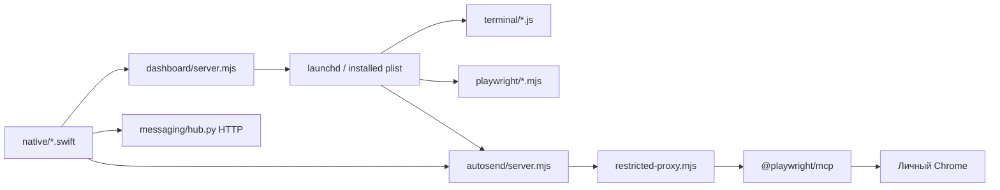
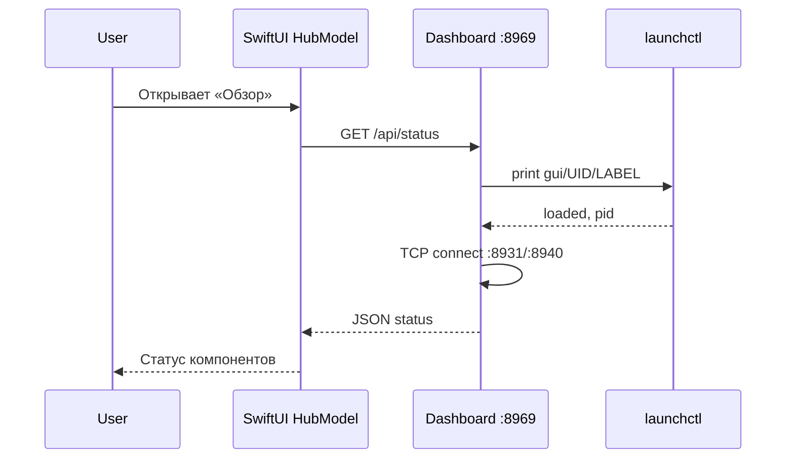
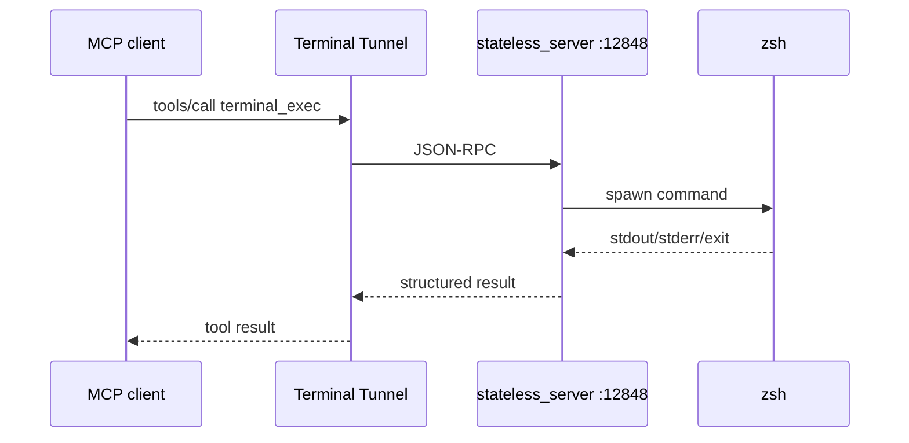
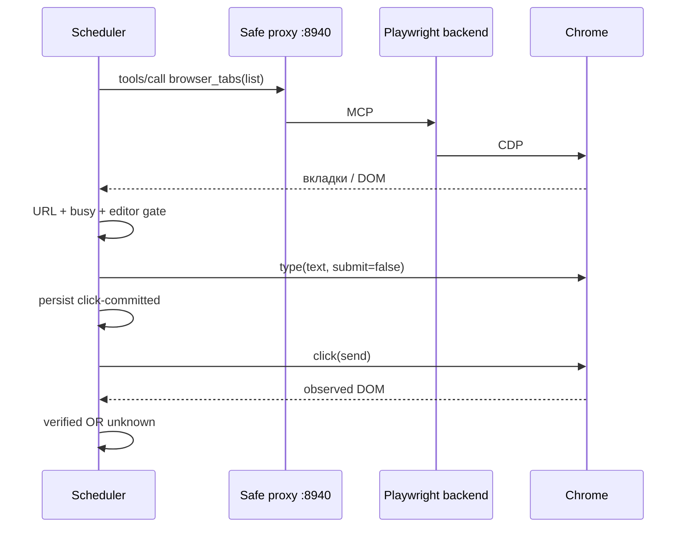

# McpGo — компонентная архитектура (source-level)

Этот документ привязывает ответственность к **конкретным файлам**. Он не является перечнем обещаний на сайте. Путь каждого модуля указан относительно корня McpGo.

## 1. Runtime и границы

| Слой | Состав | Зона ответственности | Чего не делает |
|---|---|---|---|
| View | `native/main.swift` и View-файлы | UI, запроса status/action, выбор агента | Не управляет напрямую внешним MCP |
| Dashboard | `dashboard/server.mjs` | `launchctl`, проверка PID/портов, миграция terminal tunnel plist | Не является полным менеджером пакетов |
| Stateful terminal | `terminal/server.js` + `pty_worker.py` | PTY-сессии, input/read/interrupt/close | Не возвращает synchronous exit code на каждый send |
| Stateless terminal | `terminal/stateless_server.js` | Одноразовые команды и MCP job tools | Не сохраняет интерактивную оболочку |
| Job runtime | `terminal/job_runtime.js`, `job_worker.js` | Detached subprocess, status и лог-файлы | Не гарантирует success по факту создания job |
| Browser MCP | `playwright/start.sh`, `@playwright/mcp` | Работа с пользовательским Chrome CDP | Не запускает отдельный Chromium штатно |
| Browser proxy | `playwright/restricted-proxy.mjs` | Shared session, MCP filtering, tab-index warmup | Не является web firewall |
| AutoSend | `autosend/core.mjs`, `server.mjs`, `cdp-delivery.mjs` | Очередь расписаний, DOM state, клик, итог | Не проверяет завершение ответа агента |
| Messaging | `messaging/hub.py`, `start.mjs` | Локальный реестр агентов/очередь/ack | Не раскрывает закрытый transcript |
| Tunnels | `terminal/run-tunnel.sh`, `playwright/start-tunnel.sh`, launcher wrappers | Outbound MCP transport | Не выполняет CLI разрешения пользователя за него |
| OS lifecycle | `launchagents/*.plist` | Запуск и restart после входа/сбоев | Не гарантирует CDN/backend uptime |

## 2. Последовательности вызовов

**Проверка состояния из окна:**

**Команда через Terminal OneShot:**

**Расписание AutoSend:**

## 3. Взаимодействие служб и отказов

- Если Dashboard не работает, уже запущенные terminal/browser services могут продолжать работать: Dashboard — control plane, не единственный data plane.
- Если browser proxy падает, backend 8931 может оставаться активным, однако внешний browser MCP и AutoSend теряют штатный путь.
- Если Chrome закрыт, Playwright MCP может быть активен как процесс, но browser-tools будут возвращать ошибки.
- Если AutoSend выключен, ручной browser MCP может работать: их lifecycle независим.
- Если Message service выключен, реестр недоступен UI, но terminal MCP остаётся отдельным сервисом.
- Если terminal tunnel разорван, локальные command/OneShot HTTP могут оставаться healthy, а ChatGPT tool invocation — нет.

## 4. Что означают «зеленые» статусы

`launchctl job.running` означает найденный PID; `proxyReady` означает только доступность TCP-слушателя; `configured` означает наличие необходимых значений конфигурации. Ни одно из этих полей не гарантирует успешного `tools/call` из ChatGPT.

Критерий доступности MCP — **реальный вызов инструмента через правильный подключённый tunnel**. Для AutoSend — ещё и точная проверка адресата/DOM на отдельном тестовом чате.

## 5. Исторические реализации

В `autosend/` могут сохраняться `chrome-extension/`, `native-messaging/`, `desktop.mjs`, `browser.mjs`, а также регрессионные тесты бывших транспортов. Они документируют миграцию, **не** доказывают, что extension является текущим способом доставки. Действующий scheduler зовёт `deliverViaPlaywright` из `cdp-delivery.mjs`.

В `native/` могут храниться backup binaries, bundle snapshots и исторические файлы. Для публичного source release это **артефакты разработки**, не часть рекомендуемой поставки.

## 6. Source ownership

| Изменяется | Проверяйте совместно |
|---|---|
| `dashboard/server.mjs` groups | SwiftUI state decoder, LaunchAgent labels |
| Browser proxy | `playwright/start-tunnel.sh`, browser MCP, AutoSend tests |
| Terminal job schema | `terminal/stateless_server.js`, `job_runtime.js`, Tool descriptions |
| AutoSend states | `core.mjs`, `server.mjs`, `cdp-delivery.mjs`, SwiftUI scheduled UI |
| SQLite schema | `messaging/hub.py` + tests + backup/migration docs |
| Skills | Исходники `skills/`, bundled `Resources/skills`, codesign |
| Приложение | `native/*.swift`, Info.plist, AppIcon, signatures |

См. [TERMINAL.md](TERMINAL.md), [BROWSER.md](BROWSER.md), [MESSAGING.md](MESSAGING.md), [AUTOSEND.md](AUTOSEND.md).
