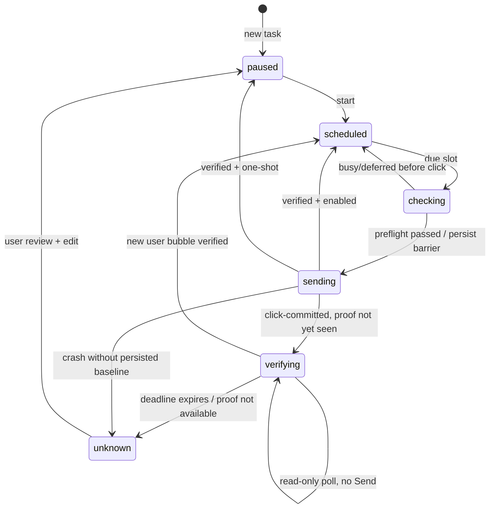

# McpGo — матрица отказов и процедуры восстановления

**Правило:** сначала определить слой отказа, затем выбирать минимальное восстановление. Слепой перезапуск всей системы может оборвать working browser session, интерактивные терминалы и незавершённую задачу.

## 1. Уровни наблюдаемости

| Уровень | Что проверяет | Чего не доказывает |
|---|---|---|
| Файл | Исполняемый скрипт существует | Что у LaunchAgent есть доступ |
| launchd | Служба зарегистрирована | Что процесс работает |
| PID | Процесс сейчас жив | Что порт слушает и принимает запрос |
| TCP | Порт принимает соединения | Что MCP initialize валиден |
| HTTP health | Приложение отвечает | Что внешний tunnel доступен |
| MCP tools/list | Инструмент опубликован | Что tool call работает с Chrome/PTY |
| MCP tool call | Конкретный вызов выполнился | Что сторонний побочный эффект достиг цели |
| User observation | Результат виден в интерфейсе | Что он сохранится после перезапуска |

## 2. Terminal tunnel: 127 и отсутствие скрипта

**Симптом:** `launchctl list` показывает `- 127 com.chatterminalhub.tunnel`, stderr сообщает, что `run-tunnel.sh` не может открыться.

**Причина уже встречалась:** рабочий plist ссылался на скрипт внутри macOS Desktop, который запускался интерактивно, но не открывался фоновой службой.

**Порядок:**
1. `launchctl print "gui/$(id -u)/com.chatterminalhub.tunnel"`.
2. Посмотреть `program`, `arguments`, `WorkingDirectory`, `last exit code`.
3. Проверить наличие `~/Library/Application Support/ChatTerminalHub/run-tunnel.sh`.
4. Убедиться, что `ProgramArguments:0` указывает на Application Support.
5. Использовать McpGo → Restart tunnel, который вызывает миграцию и bootstrap, если необходимо.
6. Проверить PID/health, затем **реальный terminal MCP вызов**.

Не менять индекс `ProgramArguments:1`: в текущем plist исполняемый скрипт — элемент `0`.

## 3. Backend и proxy Playwright

| Сбой | Диагностика | Следующее действие |
|---|---|---|
| backend :8931 не слушает | `com.mcphub.playwright.browser`, Node stderr | Проверить `npm ci`, CDP флаги |
| proxy :8940 не слушает | `com.mcphub.playwright.proxy`, `node --check` | Запустить proxy отдельно |
| browser tunnel завершился | `com.mcphub.playwright.tunnel`, настройки | Проверить endpoint 8940 и tunnel association |
| Chrome не разрешает CDP | `chrome://inspect/#remote-debugging` | Разрешить вручную |
| Многократные permission prompts | Shared session перезапускается | Проверить proxy/backend lifecycle |
| Неверная вкладка | `browser_tabs(list)`, точный URL | Не выполнять запись, выбрать нужную |

## 4. AutoSend: состояния и меры

Схема упрощает часть внутр. статусов; точная машина — `autosend/core.mjs` и `server.mjs`.

**Если agent busy:** это не поломка, расписание должно дождаться нового интервала.
**Если page deferred:** проверить URL, login, editor, готовность DOM и состояние Chrome.
**Если verifying:** только read-only наблюдение в том же чате до 180 секунд; Send не повторяется. **Если unknown:** **не** нажимать повтор и не включать расписание вслепую. Открыть точный чат и проверить наличие сообщения; после этого пользователь может изменить/переутвердить задание.
**Если CDP недоступен:** проверить proxy 8940, Chrome remote debugging, потом `browser_tabs list`.
**Если вкладка сменила URL:** не отправлять; вернуться к выбору правильного адресата.

## 5. Messaging: база и роли

| Симптом | Возможная причина |
|---|---|
| Agent не видит сообщение | Не вызвал inbox, другой ID, нет адресата |
| Публикация report отказана | Не назначен active orchestrator |
| Старый агент не принимает сообщения | Архивирован/заменён |
| Нельзя зарегистрировать старый ID | Зарезервирован для ledger истории |
| SQLite database is locked | Параллельные операции/backup/restore |
| Новая установка «пустая» | Использует другую `MCPHUB_MESSAGE_DB` / новый каталог |

Проверяйте `messaging/hub.py status`, список агентов и местоположение именно активного SQLite. При restore учитывайте WAL, ownership и foreign keys.

## 6. Mac reboot / sleep / logout

- launchd user services стартуют при входе пользователя согласно конкретным plist.
- Во сне Mac не способен гарантировать доставку сообщения в точный назначенный момент.
- CDP связывается с живым Chrome instance; после logout/close браузерная сессия недоступна.
- После restart click-committed с валидным receipt возобновляет только `verifying`; без baseline остаётся `unknown`. Повторного Send нет в обоих случаях.
- Не считать отсутствие автоматической отправки во сне багом без специально реализованного wakeup/remote worker.

## 7. Процедура управляемого перезапуска

1. Зафиксировать status, PIDs и timestamp.
2. Проверить, нет ли активного terminal session/job или AutoSend sending.
3. Если проблема локальна, перезапустить **одну** неисправную службу.
4. Проверить новый PID, порт и локальный health.
5. Проверить реальный MCP tool call из ChatGPT.
6. Убедиться, что пользовательские задания/очередь сохранились.
7. Записать инцидент и при необходимости добавить регрессионный тест.

## 8. Ошибка после обновления bundle

Если окно показывает старую надпись или старые Skills, вероятно запущен предыдущий PID приложения, хотя файлы bundle уже заменены. Полностью завершите GUI и откройте `McpGo.app`. Фоновые службы трогать не нужно, если изменялись только SwiftUI/bundled assets.

Если codesign нарушена после обновления `Resources`, восстановите согласованную сборку и повторно подпишите bundle. Не редактируйте подписанные файлы после проверки.

## 9. Чего не делать при диагностике

- Не удалять `~/Library/LaunchAgents` массово.
- Не удалять `AutoSend/tasks.json` только из-за ошибки browser UI.
- Не повторять `job_start` после timeout, не проверив эффект.
- Не отправлять тесты в рабочие чаты без отдельного разрешения.
- Не создавать новый Chromium, если штатный режим — личный Chrome.
- Не менять Bundle ID и старые label в рамках обычного исправления интерфейса.
- Не объявлять E2E PASS по одному `curl /health`.

См. [OPERATIONS.md](OPERATIONS.md), [VERIFICATION.md](VERIFICATION.md), [DATA.md](DATA.md).

## 10. MCP session expired при работающих процессах (исправление 07.11.2026)

Симптом: Dashboard показывал зелёные Playwright процессы и открытые порты, а AutoSend возвращал `404 Session not found`.

Причина: shared MCP proxy сохранял upstream session id и повторно выдавал его новым клиентам даже после потери этой сессии backend.

Поведение исправленного `playwright/restricted-proxy.mjs`:
1. Новый MCP `initialize` проверяет существующую сессию через read-only `tools/list`.
2. При `404 Session not found` сбрасывает session id, создаёт новую upstream session и продолжает.
3. Для `tools/list`, `notifications/initialized` и read-only `browser_tabs(list)` поддерживает безопасное восстановление.
4. Потенциально изменяющие операции не переисполняет при неопределённом исходе; возвращает ошибку, требующую reconnect и проверки результата.
5. Проверка Dashboard выполняет `initialize → notifications/initialized → tools/list → browser_tabs(list)` в фоне, с TTL и без блокировки UI.

Если `initialize/tools/list` успешны, но `browser_tabs` зависает, это уже **другой уровень**: Chrome CDP не отвечает на вызов. В Chrome нужно проверить `chrome://inspect/#remote-debugging` и разрешение `Allow remote debugging for this browser instance`. Нельзя лечить это бесконечным повтором действий или считать открытый порт признаком доступности вкладок.

## 11. Browser MCP list зависает при одной вкладке

При исправном Chrome CDP и доступном `tools/list` вызов `browser_tabs(list)` мог висеть до upstream timeout, если одна из вкладок не отвечала на `page.title()`. Устранено compatibility patch в `playwright/patch-playwright.mjs` и ограничением времени в `headerSnapshot`. Список больше не обязан ждать заголовок проблемной вкладки. Патч проверяется при старте backend; установка из чистого Node lockfile автоматически применяет его.

Проверка без изменения вкладок: `PLAYWRIGHT_MCP_URL=http://localhost:8940/mcp PLAYWRIGHT_MCP_REJECT_UNSAFE=1 PLAYWRIGHT_MCP_VERIFY_TABS=1 node playwright/probe.mjs`. Если проходит, Browser MCP и безопасный proxy работают. Отдельная диагностика Chrome `DevToolsActivePort` доказывает только доступность WebSocket и не является заменой этого теста.

## Явный обрыв ChatGPT

После двух наблюдений стабильного уведомления «Соединение прервано» (~15–30 секунд) один раз обновить именно открытую вкладку, повторно проверить готовность, при успехе немедленно поставить пользовательский текст продолжения на отправку. Не нажимать Stop, Regenerate, Send во время восстановления. При сохранении аварии блокировать отправку. Это отдельное состояние от долгой генерации.
