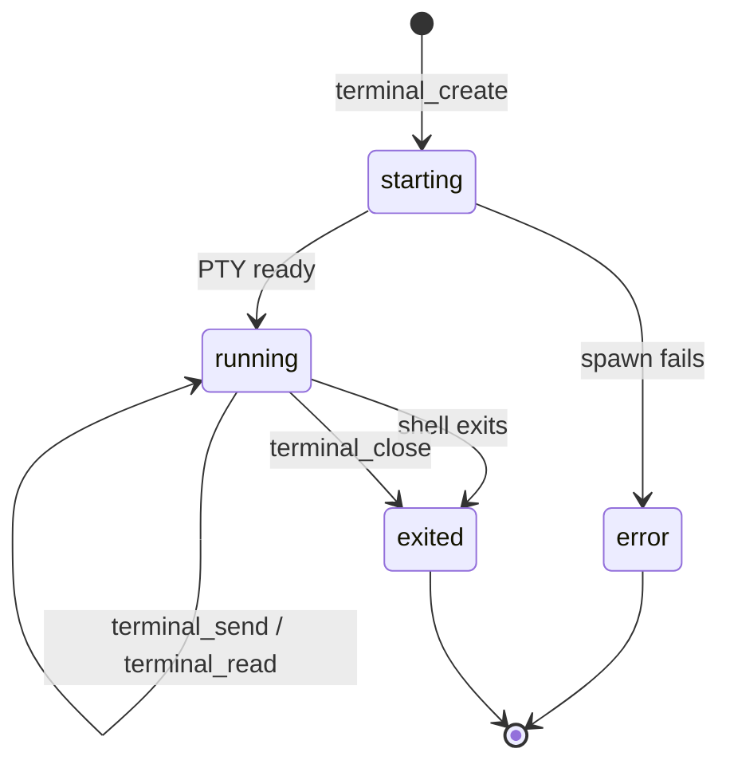

# McpGo — ChatTerminalHub: stateful PTY, OneShot и tracked jobs

## 1. Два HTTP runtime и один туннель

| Адрес | Процесс | Назначение |
|---|---|---|
| `127.0.0.1:12847` | `terminal/server.js` | Stateful PTY; MCP и локальная dashboard UI |
| `127.0.0.1:12848` | `terminal/stateless_server.js` | Одноразовое выполнение и инструменты jobs |
| Secure MCP tunnel | `terminal/run-tunnel.sh` | Outbound связь удалённого MCP-клиента с локальной реализацией |

Оба локальных сервера возвращают `GET /health`. MCP endpoint у каждого включает отдельный приватный суффикс, взятый из соответствующего конфигурационного файла: **это не публичный постоянный URL**. Не вставляйте содержимое локальных конфигураций в документацию или в issue.

## 2. Stateful PTY

`terminal/server.js` экспортирует:
- `terminal_create({name?})` — новая сессия; возвращает `session_id` и `session_key`;
- `terminal_send({session_id,session_key,text,enter?})` — поставить ввод, **не ждать** завершения;
- `terminal_read({session_id,session_key,since?})` — новые данные и `next` offset;
- `terminal_interrupt({session_id,session_key})` — Ctrl+C;
- `terminal_close({session_id,session_key})` — закрыть выбранную сессию.

### Защита сессии

`session_key` привязан к конкретному `session_id` и сравнивается constant-time; это capability внутри процесса. Разговор, который не знает пару, не должен управлять чужой сессией через MCP. Однако локальный пользователь с широкими правами на процесс/файлы — отдельная граница доверия, не multi-user isolation.

### PTY lifecycle



Worker — `terminal/pty_worker.py`, созданный через `/usr/bin/python3 -u`. Команды запускаются в zsh с пользовательским окружением. Stateful `send` возвращает `accepted`, а не exit code команды: для проверки нужно читать output до нужного признака завершения или корректного shutdown.

Реализация ограничивает максимум **12** одновременно учтённых сессий, длину retained PTY output около **262144** символов и размер request body **70000** байт. При переполнении старый вывод отбрасывается, `base` увеличивается; `terminal_read` сигнализирует `truncated` для устаревшего cursor.

## Восстановление и точечные блокировки (2.0.4)

Оба терминальных MCP входа показывают mcpgo_recover, job_status,
resource_lock_status и остальные durable job-инструменты. OneShot
terminal_exec автоматически создает durable operation_id даже без
специальных действий агента. При обрыве нужно сначала прочитать реестр,
а не повторять shell-команду. PTY terminal_send не гарантирует
отдельный durable receipt; для таких задач используйте job_start.

Ресурсные ключи применяются только к явно заданному resource_key
или консервативно распознанным простым Git/deploy/publish командам.
Независимые операции выполняются параллельно.

## 3. OneShot terminal_exec

Форма terminal_exec({command,cwd?,timeout_ms?,request_id?,resource_key?}). Обязательна непустая `command`, максимум **16000 байт UTF-8**. `cwd` должен быть существующим абсолютным каталогом, по умолчанию домашняя папка пользователя.

Команда запускается через job_worker как zsh -lc с отдельной process
group. Ответ сохраняет stdout/stderr/exit_code и добавляет
job_id, operation_id и result_ready. Если result_ready=false,
проверяйте job_status вместо повторного запуска. Тайм-аут: по умолчанию **30000 мс**, допустим **1000–90000 мс**. `stdout` и `stderr` возвращаются ограниченно, по **12000 байт** retained на поток. Более длинные данные помечаются `truncated`; потеря невозвращённого начала вывода ожидаема.

**Правило успешности:**

```text
exit_code === 0
AND timed_out === false
AND spawn_error == null
AND ожидаемый пользовательский результат действительно наблюдён
```

Нулевой exit code относится к процессу, но не доказывает сторонний effect, например доставку сообщения или завершение workflow.

## 4. Detached jobs

`terminal/job_runtime.js` реализует persistable registry, отдельный `job_worker.js` и log files. API:

| MCP tool | Назначение | Важные поля |
|---|---|---|
| `job_start({command,cwd?,timeout_ms?})` | Detached-start | `job_id`, `state=queued`, `runner_pid` |
| `job_status({job_id})` | Статус и exit | `state`, `exit_code`, `timed_out`, `spawn_error` |
| `job_logs({job_id,tail_lines?,max_chars?})` | Последние stdout/stderr | `stdout`, `stderr`, `truncated` |

По умолчанию длительная задача имеет timeout **20 минут**, разрешённый диапазон **1000 мс – 4 часа**. Формат `job_id` — 24 случайных байта в hex; он является идентификатором, не человекочитаемым названием.

Логи `job_logs`: по умолчанию **40** строк и **4000** символов, допустимо 1–200 строк и 100–12000 символов. Полное содержимое может быть намного больше, `stdout_truncated`/ограничения ответа следует учитывать.

### Корректный шаблон

```text
1. job_start
2. сохранить job_id
3. job_status, пока state не terminal
4. job_logs, если нужен диагноз
5. PASS только если state=exited, exit_code=0, timed_out=false
6. UNKNOWN/timeout → проверить внешние эффекты перед новым start
```

### Состояние unknown

Если runner PID исчез без completion receipt или worker не сообщил старт, `summarize` возвращает `unknown` с диагностической причиной. Это **не** эквивалент безопасного сбоя задачи: команда могла частично выполнить побочные действия.

## 5. Конфигурация

`terminal/config.json` и `terminal/stateless-config.json` — локальные конфигурационные файлы. Stateful HTTP позволяет `GET /api/sessions` и некоторые операции dashboard под отдельным admin/session capability. OneShot MCP также использует private path.

Для регистрации серверов в MCP workspace применяйте штатный tunnel-profile и официальные настройки подключения. Не придумывайте публичный `/mcp` root URL по одному номеру порта — у текущего сервера приватный путь.

## 6. Ошибки

| Сигнал | Что означает | Действие |
|---|---|---|
| `INVALID_COMMAND` | Пустая/слишком длинная команда | Проверить размер запроса |
| `INVALID_CWD` | Невалидная рабочая директория | Проверить абсолютный путь |
| `INVALID_TIMEOUT` | Вне разрешённого диапазона | Использовать допустимый timeout |
| `SESSION_LIMIT` | Исчерпан лимит PTY | Закрыть ненужные сессии |
| `SESSION_NOT_FOUND_OR_FORBIDDEN` | Неподходящая пара id/key | Проверить сессию, не подбирать чужую |
| `RUNNER_GONE_WITHOUT_COMPLETION_RECEIPT` | Потерян receipt | Проверить внешнее состояние |
| exit code `127` launchd | Не удалось выполнить команду/скрипт | Проверить active plist и stderr |

## 7. Реальная граница безопасности

TerminalHub — **мощный execution interface к Mac**, не jailed shell. MCP-разрешение, user confirmation для опасных операций, OS ACL и отсутствие внешней публикации портов важнее названия плагина. При публичной разработке обязательны тесты неверного capability, ограничений длин запросов, закрытия сессий и shutdown.

См. `terminal/server.js`, `terminal/stateless_server.js`, `terminal/job_runtime.js`, `terminal/job_worker.js`, `terminal/pty_worker.py`; сопутствующий runtime — [OPERATIONS.md](OPERATIONS.md).


## Reliability 2.0: восстановление после потери ответа MCP

Новый протокол подробно описан в [RELIABILITY.md](RELIABILITY.md). Инструменты терминального MCP расширены:

| Инструмент | Назначение |
|---|---|
| `job_start({command,cwd?,timeout_ms?,request_id?})` | Durable start. Стабильный `request_id` предотвращает дублирующие запуски |
| `job_recent({limit?})` | Получение ID существующих заданий после обрыва соединения |
| `job_watch({job_id,wait_ms?})` | Read-only ожидание прогресса/изменения состояния до 25 секунд |
| `job_status({job_id})` | Heartbeat, progress, stdout/stderr counters, exit code |
| `job_result({job_id})` | Сохранённый итог с SHA-256 логов |
| `job_output({job_id,stream?,offset?,max_bytes?})` | Byte-accurate страницы вывода в Base64 |
| `job_cancel({job_id})` | Запрос отмены; ожидать конечного receipt |
| `job_logs({job_id,...})` | Ограниченный хвост строк |

Используйте `request_id` при работе с долгими задачами и не создавайте новый для повторения уже отправленного запроса после потери MCP-ответа. В текущем runtime сохраняются первые 64 MiB stdout и stderr на поток, затем выставляется `truncated`. Полное отсутствие stdout не является доказательством зависания, если heartbeat обновляется.

Для изолированных тестов используются `MCPGO_JOB_ROOT`, `MCPGO_ONESHOT_CONFIG` и `MCPGO_ONESHOT_PORT`, без доступа к действующим пользовательским заданиям.
